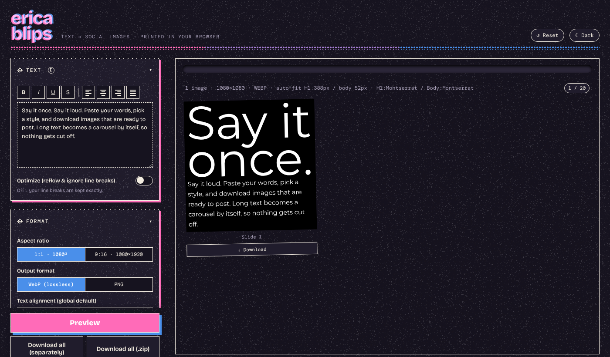

# Erica Blips

Turn text into social media images. Paste your text, choose a style, and download square (1:1) or tall (9:16) images. Long text becomes a carousel automatically.

**Live version:** https://lab.captainerica.com/erica-blips/



Everything runs in your browser. There is no server, no account, and no AI. Your text never leaves your computer.

## Features

- **Two formats:** 1:1 (1080×1080) and 9:16 (1080×1920).
- **Automatic carousel:** long text splits across up to 20 images. Short text stays on one image.
- **Headline and body:** the first sentence becomes a large headline on slide 1. The rest is body text.
- **Auto-fit:** the text grows to fill each slide. You can turn this off and set exact sizes.
- **71 fonts:** choose the headline and body fonts separately, or pick random fonts.
- **10 print styles:** Plain, Riso, Halftone, Cut paper, Misprint, Blueprint, Notebook, Neon, Sunset, and Terminal. You can give each slide its own style.
- **Text formatting:** bold, italic, underline, strikethrough, and alignment for each block.
- **Colors:** white on black, black on white, or a custom color. The app checks the contrast for you.
- **Export:** lossless WebP or PNG. Download one slide, all slides, or a single `.zip` file.
- **Works offline:** all code and fonts are in this folder.
- **Saves your work:** the app keeps your text and settings in your browser, so a refresh does not lose them.

## Run it

You do not need to install anything or build anything.

1. Download or clone this repository.
2. Open `index.html` in a modern browser.

Some browsers block certain features when a page opens from a file. The app has a fallback for this, but you can also run a small local server:

```
python3 -m http.server 8000
```

Then open http://localhost:8000.

## Host it

Erica Blips is a static site. Upload the whole folder to any web host, such as GitHub Pages, Netlify, Cloudflare Pages, nginx, or Apache. There is no build step.

## Settings

The full list of settings, defaults, and rules is in [docs/REFERENCE.md](docs/REFERENCE.md).

## Report a problem

Open an issue: https://github.com/ericakfranz/erica-blips/issues

Please include your browser name, the text and settings you used, and a screenshot if you can.

## Credits and licenses

Erica Blips is released under the [MIT License](LICENSE).

It uses these open-source libraries, stored in `vendor/`:

- [html-to-image](https://github.com/bubkoo/html-to-image) (MIT) draws the slide into an image.
- [JSZip](https://stuk.github.io/jszip/) 3.10.1 (MIT or GPLv3) creates the `.zip` file.
- [FileSaver.js](https://github.com/eligrey/FileSaver.js) (MIT) starts the downloads.

The fonts come from [Google Fonts](https://fonts.google.com). The font files are in `assets/fonts/`, and the interface fonts (Bricolage Grotesque and DM Mono) are in `assets/ui-fonts/`. 72 fonts use the SIL Open Font License 1.1, and Syncopate uses the Apache License 2.0. The full license text for every font is in [assets/FONT-LICENSES.txt](assets/FONT-LICENSES.txt).
